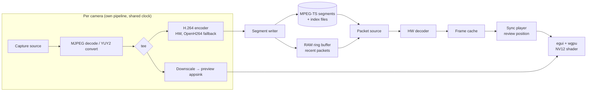

# VAR for Trampoline — Implementation Plan

| | |
|---|---|
| **Document status** | Draft v0.2 |
| **Date** | 2026-10-16 |
| **Based on** | Software Requirements Specification, Draft v0.3 |

---

## 1. Approach

Development proceeds in 15 small steps (0–14). The application is a GUI application from the very first step: every step adds visible functionality to the same application window, and each step ends with something that runs and can be checked against concrete verification criteria.

The order follows the risk: the parts that are hardest to get right (capture, encoding, synchronisation, review while recording) come first, and the parts that are easy but visible (lock mode, drawing, polish) come later.

Three milestones mark points where the software is usable on its own:

| Milestone | After step | What it is |
|---|---|---|
| **A — Recorder** | 4 | Selects cameras, shows live view and records all feeds reliably, including camera failures. Usable as a pure recording tool at an event. |
| **B — Basic review** | 7 | Synchronised review while recording, with slow motion, frame stepping and jump hotkeys. Usable as a basic VAR. |
| **C — Full application** | 14 | All requirements of the SRS implemented, endurance-tested and packaged. |

Requirement IDs refer to the SRS. **(partial)** means the step implements part of a requirement; the step in which the requirement is completed is listed in the traceability matrix (section 6).

---

## 2. Architecture decisions

These decisions are made now so the steps can build on them. Each is validated in an early step; if a validation fails, the decision is revisited before moving on.

| # | Decision | Rationale | Validated in |
|---|---|---|---|
| AD-1 | **GStreamer** (via `gstreamer-rs`) for capture, MJPEG decoding, pixel format conversion, hardware encoding and decoding. | One API for camera sources on all three OSes (`mfvideosrc`, `avfvideosrc`, `v4l2src`), device enumeration via `DeviceMonitor`, and access to hardware encoders (NVENC, Quick Sync, AMF, Media Foundation, VideoToolbox, VA-API). LGPL, so compatible with PLT-006/007. | Steps 0–2 |
| AD-2 | **H.264** as recording codec, hardware encoder selected at runtime from a priority list, **OpenH264** as software fallback. | Widest hardware encoder support, including APUs. OpenH264 (BSD, Cisco binary) avoids GPL x264 in the MSI. | Step 2 |
| AD-3 | **MPEG-TS segments** as recording container, written by the application's own writer component, with a sidecar **index** per segment. | MPEG-TS is append-only and readable while growing (needed for review while recording), survives crashes without finalisation (REC-012) and plays in VLC (EXP-001). The index maps each frame to wall-clock time, keyframe flag and byte offset, which makes seeking, frame stepping and review of the growing segment fast and independent of GStreamer's file seeking. | Steps 2–3, 6 |
| AD-4 | **Short GOP** (keyframe every 0.5 s). | Frame stepping backwards and reverse playback must decode from the previous keyframe. A short GOP bounds that work to ≤ 30 frames. The bitrate cost is negligible at 15 Mbit/s. | Step 7 |
| AD-5 | **One GStreamer pipeline per camera, all sharing one clock.** Every frame is timestamped at capture with the shared monotonic clock and converted to wall-clock time via a single anchor taken at recording start. | Separate pipelines isolate camera failures (REC-004). The shared clock gives comparable timestamps across cameras (CAP-009). A single anchor keeps wall-clock time free of jumps from NTP adjustments during the event. | Steps 3–4 |
| AD-6 | **Review synchronises by timestamp, not by frame number.** The player has one review position in wall-clock time; each camera displays the latest frame whose timestamp is ≤ that position. | Works with cameras that drop or duplicate frames, and with mixed 50/60 fps. | Step 5 |
| AD-7 | **egui (eframe) with the wgpu backend** for the UI. Video frames are uploaded as NV12 textures and converted to RGB in a wgpu shader. | Immediate mode suits constantly changing video, keyboard-driven tool UIs and the laser pointer overlay. GPU colour conversion keeps CPU load low. Iced with a custom wgpu widget is the fallback if egui proves limiting. | Steps 0–1 |
| AD-8 | **Single process, multithreaded**, with capture, recording and playback in their own crates that have no UI dependency. | Simpler than a multi-process design, which the SRS doesn't require (no crash restart, REC-012 is a Could). The crate boundaries keep the core testable without the GUI and keep the option of moving the recorder into a separate process later. | Step 3 |

### 2.1 Crate layout

```
var/                      Cargo workspace (MIT)
├─ var-app/               The application: eframe/egui UI (setup, live grid, review, lock mode)
├─ var-core/              Config, wall-clock/timestamp types, markers, PIN hashing, logging setup
├─ var-capture/           Device enumeration, per-camera capture pipelines, preview frames
├─ var-record/            Encoding, segment writer, index, disk monitoring
├─ var-playback/          Index reader, packet source (RAM/disk), decoders, frame cache, sync player
├─ var-control/           Local control interface for Bitfocus Companion (step 13)
└─ dev-tools/
   └─ var-check/          Development tool: analyse recordings (frame gaps, bitrate, sync, segments).
                          Not part of the delivered application.
```

The application is the only user-facing entry point. The core crates are additionally exercised by headless integration tests in CI (see section 3).

### 2.2 Data flow



---

## 3. Test infrastructure

Built up from step 0 and used for verification throughout.

- **Synthetic camera.** A test source (GStreamer `videotestsrc` with burned-in frame counter and timestamp) that appears in the application's device list like a real camera when started with a debug flag. Makes most tests possible without hardware.
- **Headless integration tests.** The core crates (`var-capture`, `var-record`, `var-playback`) are tested in CI with the synthetic camera, without starting the GUI.
- **`var-check`.** Development tool that analyses a recording: frame count vs. duration, timestamp gaps, dropped frames, average bitrate, segment continuity, presence of audio tracks, and cross-camera sync (finds a brightness flash in all feeds and reports the offset in frames).
- **CI matrix.** Builds the application and runs the integration tests on Windows 11, macOS 14 and Ubuntu 26.04.
- **Manual test checklists.** One per step, run in the GUI with real capture cards on all three OSes. Results are recorded in the repository.
- **Flash test.** A camera flash or LED visible to all cameras, for sync verification with real hardware.
- **Latency test.** A millisecond clock on a screen in view of a camera, for live view and review latency.

---

## 4. Development steps

### Step 0 — Application skeleton with device list

**Goal:** The application window opens on all three OSes and shows the connected cameras.

**Deliverables**
- Cargo workspace with the crate layout from 2.1, MIT `LICENSE`, `cargo-deny` licence check.
- CI pipeline for Windows, macOS and Linux with GStreamer installed.
- Logging (`tracing`) to console and file.
- eframe/egui application with the wgpu backend, opening a main window with an empty setup screen.
- Setup screen lists all capture devices (via `DeviceMonitor`) with name, ID and supported modes (resolution, frame rate, pixel format). The list updates when devices are plugged in or removed.
- Synthetic camera available in the device list with the debug flag.

**Requirements:** PLT-002, PLT-005, PLT-001 (partial: CI), CAP-005 (partial: enumeration), NFR-003 (partial), NFR-005 (partial: logging framework).

**Verification**
- CI is green on all three OSes.
- On each OS with real capture cards, the setup screen lists the cards with their 1080p50/60 modes and MJPEG/YUY2 formats.
- Plugging and unplugging a card updates the list within 2 s.

---

### Step 1 — Live view of one camera

**Goal:** One selected camera is shown live in the application, using the final rendering path.

**Deliverables**
- Setup screen: select one device and a mode.
- Capture pipeline handling MJPEG (decode) and YUY2 (convert to NV12).
- Preview frames delivered to the UI and rendered as NV12 textures with GPU colour conversion (AD-7).
- Frame rate and dropped-frame counter shown in a debug overlay.

**Requirements:** CAP-004, CAP-002 (partial: live capture at 50/60 fps), CAP-005 (partial: one camera), CAP-006 (partial), CAP-008 (partial: one camera), VIEW-003 (partial).

**Verification**
- Live view of an MJPEG and a YUY2 device at 1080p50 and 1080p60 on each OS, without dropped frames for 10 minutes (debug overlay).
- Live view latency ≤ 200 ms (latency test).
- CPU and GPU load recorded as a baseline.

---

### Step 2 — Recording one camera

**Goal:** The live camera can be recorded from the GUI with the final encoding chain.

**Deliverables**
- Start/Stop recording buttons (stop with confirmation); recording folder selectable in setup.
- Encoding branch added to the capture pipeline: hardware encoder chosen from a per-OS priority list, OpenH264 as fallback. A debug option forces the fallback for testing.
- Encoder in use shown in the setup screen and logged.
- Bitrate 15 Mbit/s for 50 fps, 18 Mbit/s for 60 fps; GOP 0.5 s; no audio.
- Recording written as a single MPEG-TS file for now.
- `var-check` (first version): frame count, gaps, bitrate, tracks.

**Requirements:** CAP-002, REC-007, REC-007a, REC-007b, REC-008, REC-013, REC-001 (partial: one camera), EXP-001 (partial: format), EXP-002 (partial: confirmation), PLT-007 (partial: encoder choice), NFR-004 (partial: measured per step).

**Verification**
- 10-minute recordings at 1080p50 and 1080p60, with an MJPEG and a YUY2 device, on each OS.
- `var-check`: no dropped frames, bitrate within ±20 % of target, no audio track.
- Files play in VLC on all three OSes.
- Setup screen and log show a hardware encoder on each test machine; with the fallback forced, OpenH264 is used and recording still meets the frame rate.
- Live view continues without stutter while recording.

---

### Step 3 — Two cameras, segments and timestamps

**Goal:** Two synchronised cameras in a grid, recorded in segments with an index.

**Deliverables**
- Setup screen: device and mode per camera slot (two slots).
- Live grid of both cameras; any camera toggles to full screen.
- One pipeline per camera, shared clock, wall-clock anchor at recording start (AD-5). One Start action records all cameras.
- Segment writer: rolls over to a new segment on a keyframe after the configured length (default 10 minutes). Writes an index per segment (frame timestamp → wall-clock time, keyframe flag, byte offset).
- Recording folder layout: one folder per event, one subfolder per camera.
- `var-check`: segment continuity across boundaries, flash-sync analysis.

**Requirements:** CAP-001, CAP-005, CAP-008, CAP-009 (partial: capture timestamps), REC-001, REC-009 (partial: files), REC-010 (partial: writer tolerates moved segments), REC-012, VIEW-001, VIEW-002 (partial: live), VIEW-003.

**Verification**
- Flash test with two real cameras: `var-check` reports ≤ 1 frame offset between the timestamps of the flash frames.
- 1-hour recording: segment boundaries have no gaps or duplicate frames.
- Killing the application during recording: all completed segments and the partial last segment play in VLC.
- Moving a completed segment to another drive during recording produces no error and no gap in the recording.
- Full-screen toggle works for each camera in the live grid.

---

### Step 4 — Camera failure, status bar and configuration

**Goal:** The recorder is robust enough for use at an event.

**Deliverables**
- Failure detection per camera: pipeline error or no frames for 1 s (watchdog). The failed pipeline is torn down without touching the others; the device is polled via `DeviceMonitor` and the camera restarts into a new segment when it reappears.
- Stable device identification (by device path, serial or USB topology, depending on OS) so reconnects and restarts map to the same camera slot.
- Status bar: recording active, elapsed time, per-camera health; visible alarm on camera failure in the camera's tile and the status bar.
- Camera and format settings disabled while recording.
- Configuration saved and restored on start.
- MSI smoke build in CI (bundling GStreamer), to catch packaging problems early.

**Requirements:** REC-004, REC-005, REC-006, CAP-006, CAP-007, CAP-010, VIEW-005 (partial: without disk time), REC-002 (partial), NFR-003, PLT-003 (partial: smoke build).

**Verification**
- Unplug one camera for 30 s during recording: the alarm appears within 2 s; `var-check` shows the other camera's recording continuous; the failed camera's recording resumes within 5 s of replugging.
- Repeat 20 times in one session without memory growth or stuck pipelines.
- After restarting the application (and after a reboot), the previous camera configuration is restored and mapped to the same physical cards.
- Camera and mode selection are disabled while recording.
- MSI builds and starts on a clean Windows 11 machine.

**→ Milestone A: Recorder.**

---

### Step 5 — Review of finished recordings

**Goal:** Synchronised playback engine, first against completed recordings.

**Deliverables**
- Index reader; packet source reading MPEG-TS from disk via the index.
- Hardware decoder per camera, frame cache, sync player with a single review position (AD-6).
- Review screen: grid of all cameras, play/pause at 1×, scrub bar over the whole recording labelled with wall-clock time (continuing as 0:00 after 23:59), wall-clock time of the current frame.
- Playback continues seamlessly across segment boundaries; missing (moved) segments are skipped without error.

**Requirements:** CAP-009, REC-009, REC-010 (partial: missing segments tolerated), REV-007, REV-007a, VIEW-007, REV-001 (partial: finished recordings).

**Verification**
- Flash test recording: in review, the flash appears on all cameras within ±1 frame.
- Playback across 5 segment boundaries without visible stutter or loss of sync.
- Midnight: synthetic recording with the wall-clock anchor set to 23:55 shows continuous labels 23:59 → 0:00 and navigation across midnight works.
- Recording with one segment removed: review works, scrub bar remains usable.

---

### Step 6 — Review while recording

**Goal:** Review during a running recording, with no influence on it.

**Deliverables**
- Writer publishes index updates live; packet source reads the growing current segment and a RAM ring buffer of recent packets.
- Live mode / review mode switch: in review mode the grid shows recorded video and no live view; one action returns to live.
- Full-screen toggle in review mode.
- Recording and review run on separate threads with bounded queues, so that review load can't back up the recorder.

**Requirements:** REV-001, REV-002, REV-009, REV-010, VIEW-002, VIEW-004, REC-003 (partial: review actions), REC-010.

**Verification**
- Latency test: an event in the live feed is reviewable within 1 s.
- 1-hour session with continuous review use (scrubbing, mode switching every few seconds, full-screen toggles): `var-check` reports no dropped frames and no gaps.
- Moving a completed segment during review: no error, recording unaffected.

---

### Step 7 — Slow motion, frame stepping and jump hotkeys

**Goal:** The core review functions referees need.

**Deliverables**
- Playback speeds 2×, 1×, 0.5×, 0.25×, 0.1×.
- Frame step forward and backward (backward decodes from the previous keyframe into the frame cache).
- Hotkeys for jumping ±1 s, ±10 s, ±60 s.
- Keyboard shortcuts for all review functions.

**Requirements:** REV-003, REV-004, REV-006, INP-001 (partial: review functions).

**Verification** (with the synthetic camera's burned-in frame counter, then with real cameras)
- Each frame step changes the displayed frame counter by exactly 1 on all cameras, in both directions, including across a keyframe and a segment boundary.
- Playback speed measured within ±5 % for each speed.
- Jumps move the review position by the stated time on all cameras.
- Backward step responds within 100 ms.

**→ Milestone B: Basic review.**

---

### Step 8 — Markers

**Deliverables**
- Hotkey sets a marker at the current live time (live mode) or the current review position (review mode).
- Next/previous marker hotkeys; marker list with wall-clock times; markers drawn on the scrub bar.
- Markers appended to a JSON file in the event folder as they are created; loaded on restart. No editing or deletion.

**Requirements:** MRK-001, MRK-002, MRK-003, MRK-004, MRK-005, MRK-006, MRK-007, REV-008, INP-001 (partial: marker functions).

**Verification**
- Markers set in live and review mode appear at the correct position; jumping lands on the marked frame on all cameras.
- After restarting the application, all markers are present.
- Setting 100 markers during recording causes no gaps (`var-check`).

---

### Step 9 — Disk space monitoring

**Deliverables**
- Free space and estimated remaining recording time in setup (based on configured bitrates) and during recording (based on measured bitrates).
- Remaining disk time added to the status bar.
- Warnings at configurable thresholds (default 2 h and 30 min).

**Requirements:** DSK-001, DSK-002, DSK-003, VIEW-005.

**Verification**
- Estimate matches actual consumption within ±10 % after 30 minutes of recording.
- With free space simulated below each threshold, the warning appears.

---

### Step 10 — Lock mode and system protection

**Deliverables**
- Application starts unlocked; "Lock settings" (only when a PIN is set) hides or disables setup, start/stop recording and quitting; review, drawing and markers stay available.
- "Unlock settings" with PIN (stored hashed with Argon2). Mode indicator always visible.
- Quit interception: window close, Alt+F4, Cmd+Q and menu actions ignored in locked mode; confirmation when quitting unlocked during recording.
- Sleep and screen saver inhibition while recording (Windows `SetThreadExecutionState`, macOS IOPM assertion, Linux D-Bus inhibit).

**Requirements:** ROLE-001 – ROLE-008, SYS-001, SYS-001a, SYS-002, EXP-002, REC-003, NFR-005 (partial: lock/unlock logged).

**Verification**
- Checklist on each OS: every quit method in locked mode leaves the application running; wrong PIN refused; no other PIN prompts exist.
- All review, drawing and marker functions work in locked mode.
- 2-hour idle recording: no sleep, no screen saver.
- Full REC-003 test: every user action from the SRS list performed during a recording, `var-check` shows no gaps.

---

### Step 11 — Laser pointer drawing

**Deliverables**
- In review mode, mouse drag draws trails on the video, fading out after about 3 s. Overlay only; nothing saved.

**Requirements:** DRW-001, DRW-002, DRW-003.

**Verification**
- Trails fade automatically; recordings and marker files contain no drawing data.
- Drawing during playback at 1× doesn't reduce the display frame rate.

---

### Step 12 — Reverse slow motion

**Deliverables**
- Reverse playback at 0.5×, 0.25× and 0.1×, decoding GOP by GOP backwards into the frame cache.

**Requirements:** REV-005.

**Verification**
- Synthetic camera: frame counter decreases by exactly 1 per displayed frame, at the measured speed ±5 %, across keyframe and segment boundaries.
- Smooth on the slowest supported test machine.

---

### Step 13 — Hardening, endurance and control interface

**Deliverables**
- 12-hour endurance runs on each OS with two real cameras and scripted review activity (memory, CPU, frame drops, file handles monitored).
- Fixes from endurance runs.
- Help overlay listing all keyboard shortcuts.
- Control interface for Bitfocus Companion: text protocol over TCP, listening on the network (all interfaces, so Companion can run on another computer), disabled by default; review, marker and view functions only. No Stream Deck integration yet.
- Check that nothing requires network access.

**Requirements:** NFR-001, NFR-002, NFR-004, NFR-005, REC-002, INP-001, INP-002, INP-003.

**Verification**
- 12-hour runs pass on all three OSes: no crash, no dropped frames (`var-check`), memory stable within ±5 % after the first hour.
- All functions work with networking disabled.
- Help overlay covers every shortcut in the code (checked by a test that compares the shortcut table with the overlay).

---

### Step 14 — Packaging and release

**Deliverables**
- Windows MSI (e.g. `cargo-wix`) bundling the GStreamer runtime with only the required plugins, plus licence texts and notices of all bundled components.
- Build instructions for macOS and Linux.
- Licence review: `cargo-deny` for Rust crates, manual review of bundled GStreamer plugins and OpenH264 (no GPL components).
- Final acceptance run of all SRS acceptance criteria on all three OSes, with at least two capture card models per OS (MJPEG and YUY2).

**Requirements:** PLT-001, PLT-003, PLT-004, PLT-006, PLT-007, CAP-003, EXP-001.

**Verification**
- MSI installs, runs and uninstalls cleanly on a fresh Windows 11 machine.
- A fresh macOS 14 and Ubuntu 26.04 machine builds and runs the application following only the build instructions.
- Every bundled component has its licence notice in the installation.
- All acceptance criteria pass.

**→ Milestone C: Full application.**

---

## 5. Requirements not implemented

These are "Won't" or informational items in the SRS. They are listed here so the matrix is complete.

| ID | Note |
|---|---|
| REC-006a | Camera gap not visualised on the scrub bar. |
| REC-011 | Implementation detail; resolved by AD-2 and AD-3. |
| VIEW-006 | No second display. |
| MRK-008 | No marker annotations or scoring integration. |
| INP-004 | No Stream Deck integration; interface prepared in step 13. |
| EXP-003 | Cross-file time sync not persisted. (The index files contain it anyway, as a by-product of AD-3.) |
| SYS-003 | No automatic restart after a crash. |

---

## 6. Traceability matrix

Steps in **bold** complete the requirement; other steps contribute partially.

| Requirement | Steps | | Requirement | Steps |
|---|---|---|---|---|
| ROLE-001 – 008 | **10** | | REV-001 | 5, **6** |
| CAP-001 | **3** | | REV-002 | **6** |
| CAP-002 | 1, **2** | | REV-003 | **7** |
| CAP-003 | 1, **14** | | REV-004 | **7** |
| CAP-004 | **1** | | REV-005 | **12** |
| CAP-005 | 0, 1, **3** | | REV-006 | **7** |
| CAP-006 | 1, **4** | | REV-007 | **5** |
| CAP-007 | **4** | | REV-007a | **5** |
| CAP-008 | 1, **3** | | REV-008 | **8** |
| CAP-009 | 3, **5** | | REV-009 | **6** |
| CAP-010 | **4** | | REV-010 | **6** |
| REC-001 | 2, **3** | | DRW-001 – 003 | **11** |
| REC-002 | 4, **13** | | MRK-001 – 007 | **8** |
| REC-003 | 6, **10** | | INP-001 | 7, 8, **13** |
| REC-004 | **4** | | INP-002 | **13** |
| REC-005 | **4** | | INP-003 | **13** |
| REC-006 | **4** | | EXP-001 | 2, **14** |
| REC-007 | **2** | | EXP-002 | 2, **10** |
| REC-007a | **2** | | SYS-001, 001a, 002 | **10** |
| REC-007b | **2** | | NFR-001 | **13** |
| REC-008 | **2** | | NFR-002 | **13** |
| REC-009 | 3, **5** | | NFR-003 | 0, **4** |
| REC-010 | 3, 5, **6** | | NFR-004 | 2, **13** |
| REC-012 | **3** | | NFR-005 | 0, 10, **13** |
| REC-013 | **2** | | PLT-001 | 0, **14** |
| DSK-001 – 003 | **9** | | PLT-002 | **0** |
| VIEW-001 | **3** | | PLT-003 | 4, **14** |
| VIEW-002 | 3, **6** | | PLT-004 | **14** |
| VIEW-003 | 1, **3** | | PLT-005 | **0** |
| VIEW-004 | **6** | | PLT-006 | **14** |
| VIEW-005 | 4, **9** | | PLT-007 | 2, **14** |
| VIEW-007 | **5** | | | |

---

## 7. Risks

| Risk | Impact | Mitigation | Checked in |
|---|---|---|---|
| Capture cards behave differently per OS source element (supported formats, MJPEG via Media Foundation, AVFoundation with capture cards). | Cameras unusable on one OS. | Test real cards on all OSes from step 0; keep a compatibility list. | 0, 1 |
| egui/wgpu rendering of 2 × 1080p60 live video plus UI is too slow on laptop GPUs. | Choppy live view or review. | Measure in step 1 with one camera and in step 3 with two; downscaled preview textures; fall back to Iced (AD-7) if needed. | 1, 3 |
| No hardware encoder reachable through GStreamer on some machines. | Higher CPU load with OpenH264 at 2 × 1080p60. | Measure OpenH264 load early; document minimum CPU for the fallback. | 2 |
| Capture cards have different internal latencies, so arrival timestamps differ by more than 1 frame even with a shared clock. | CAP-009 not met. | Measure with the flash test in step 3. If needed, add a per-camera time offset set during setup (this would be a new SRS requirement). | 3 |
| Reading a growing MPEG-TS segment while it is written. | Review latency or stability problems. | Own index and packet source (AD-3) plus RAM ring buffer, so review never depends on parsing an incomplete file end. | 6 |
| Backward stepping or reverse playback too slow with 2 × 1080p60 decoding. | Sluggish review. | Short GOP (AD-4), hardware decoding, decoded-frame cache per GOP. | 7, 12 |
| Cmd+Q or OS-level quit can't be intercepted on every platform. | SYS-001 not fully met. | Test interception early (step 2, when stopping needs a confirmation); document any OS limits (e.g. force quit, logout) in the SRS. | 2, 10 |
| Bundling GStreamer in the MSI is large or fragile. | Release delay. | MSI smoke build in CI from step 4; bundle only required plugins. | 4, 14 |
